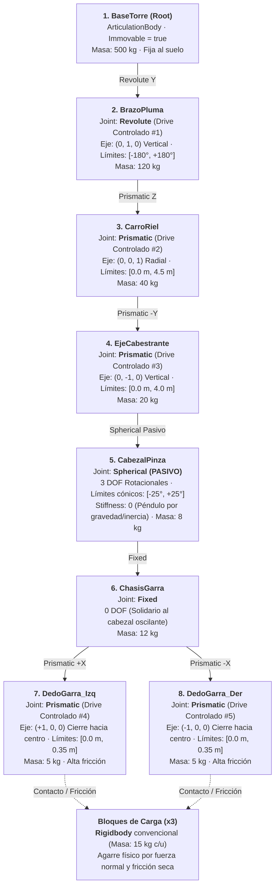

# Simulador de Grúa de Batería de Gravedad (`ArticulationBody`)

Prototipo funcional de simulador físico desarrollado en **Unity 6 (`6000.4.5f1`)** para la materia **Simuladores** (Licenciatura en Desarrollo de Videojuegos y Simulaciones · 2.º año).

---

## 1. Descripción de la Máquina y Operación Simulada

Una **Batería de Gravedad** es un sistema de almacenamiento de energía mecánica a gran escala: cuando hay excedente energético, una grúa torre eleva pesados bloques de hormigón desde el nivel del suelo y los apila a gran altura (almacenando energía potencial gravitatoria $E_p = m \cdot g \cdot h$). Para liberar energía, el sistema realiza la maniobra inversa descendiendo los bloques de forma controlada.

### Maniobra a realizar por el operador
1. **Posicionamiento:** Rotar la pluma (`BrazoPluma`) y desplazar radialmente el carro (`CarroRiel`) hasta alinear la garra sobre la zona de bloques de carga (`Rigidbody`).
2. **Descenso y Acoplamiento:** Extender verticalmente el cabestrante (`EjeCabestrante`) amortiguando las oscilaciones del cabezal pasivo (`CabezalPinza`) y cerrar las mordazas (`DedoGarra_Izq` y `DedoGarra_Der`) para prensar el bloque por **fricción estática pura** ($F_{\text{fricción}} \ge m \cdot g$), sin emparentamiento por código.
3. **Izado y Apilado (Carga de la Batería):** Elevar el bloque, rotar la pluma hacia la plataforma/torre de almacenamiento y depositarlo apilándolo de forma estable.

---

## 2. Diagrama del Árbol de Articulación (Mermaid)

---

## 3. Especificación de Cuerpos, Límites y Parámetros de Drives

Los valores de `stiffness`, `damping` y `forceLimit` se escalonan desde la raíz hacia los extremos para garantizar estabilidad numérica en el solver de Featherstone (PhysX):

| # | Cuerpo (`GameObject`) | Padre | Tipo de Joint | Eje de Movimiento | Límites | Masa (kg) | Stiffness | Damping | Force Limit | Rol / Modo |
| :-: | :--- | :--- | :--- | :---: | :---: | :---: | :---: | :---: | :---: | :--- |
| **1** | `BaseTorre` | *(Escena)* | *Root (`Immovable`)* | — | — | `500` | — | — | — | Raíz fija al suelo |
| **2** | `BrazoPluma` | `BaseTorre` | `Revolute` | `(0, 1, 0)` | `[-180°, +180°]` | `120` | `80000` | `15000` | `100000` | Giro horizontal (`xDrive`) |
| **3** | `CarroRiel` | `BrazoPluma` | `Prismatic` | `(0, 0, 1)` | `[0.0 m, 4.5 m]` | `40` | `50000` | `8000` | `60000` | Traslación radial (`xDrive`) |
| **4** | `EjeCabestrante` | `CarroRiel` | `Prismatic` | `(0, -1, 0)` | `[0.0 m, 4.0 m]` | `20` | `60000` | `9000` | `80000` | Izado vertical (`xDrive`) |
| **5** | `CabezalPinza` | `EjeCabestrante` | `Spherical` | 3 ejes rot. | `[-25°, +25°]` | `8` | **`0`** | `4` | `0` | **Pasivo** (gravedad/inercia) |
| **6** | `ChasisGarra` | `CabezalPinza` | `Fixed` | Bloqueado (0 DOF) | — | `12` | — | — | — | Soporte estructural de mordazas |
| **7** | `DedoGarra_Izq` | `ChasisGarra` | `Prismatic` | `(+1, 0, 0)` | `[0.0 m, 0.35 m]` | `5` | `25000` | `2500` | `12000` | Mordaza izquierda (`xDrive`) |
| **8** | `DedoGarra_Der` | `ChasisGarra` | `Prismatic` | `(-1, 0, 0)` | `[0.0 m, 0.35 m]` | `5` | `25000` | `2500` | `12000` | Mordaza derecha (`xDrive`) |

---

## 4. Instrucciones de Uso en el Editor de Unity

Se incluye una herramienta de construcción automática en el menú superior del Editor de Unity (`Simulador -> Batería de Gravedad`):

1. **`1. Construir en Modo Caída Libre (Fase 2 - Sin Drives)`**: Genera la jerarquía completa con escala `(1, 1, 1)`, anclas en los pivotes exactos y `stiffness = 0`, permitiendo probar la caída por gravedad y el respeto de los límites mecánicos.
2. **`2. Construir con Drives Sintonizados (Fase 3 - Con Drives)`**: Genera la escena completa con los drives calibrados de la raíz a la punta, bloques de carga con `Rigidbody` y materiales físicos de alta fricción.
